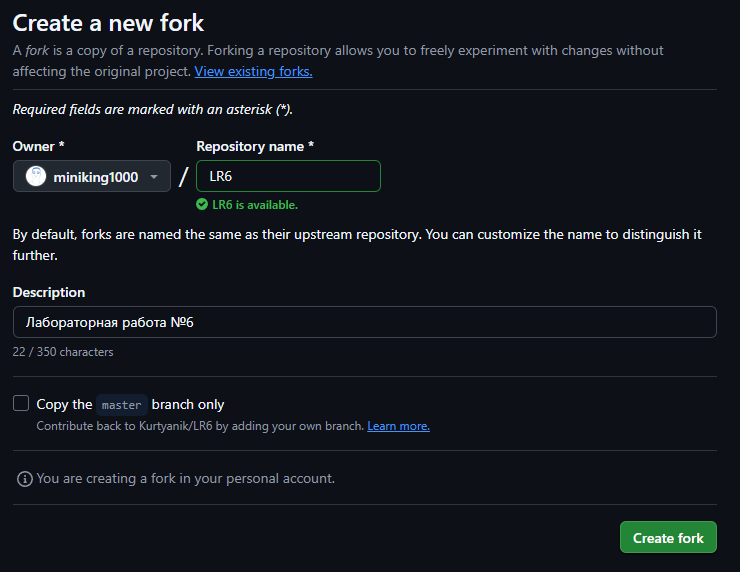
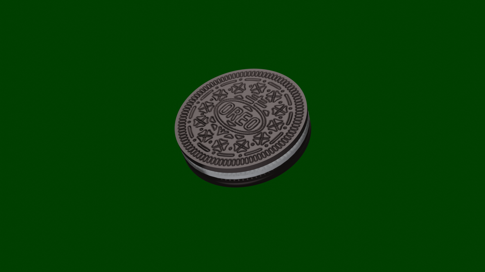
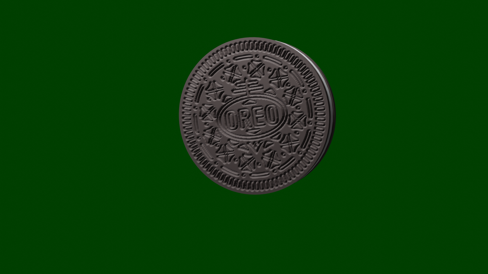

# LR6
Лабораторная работа №6

## 1. Цель работы
Изучение базовых возможностей системы управления версиями, опыт работы с Git Api, опыт работы с локальным и удаленным репозиторием.

## 2. Последовательность выполнения работы
Для выполнения этой лабораторной работы нужно создать аккаунт GitHub, однако, так-как он у меня уже был, то первый шаг был уже выполнен.  
Далее нужно было сделать форк репозитория LR6. Так-как у меня уже был опыт работы с github, то проблем это не составило.  
  
Рисунок 1 — форк репозитория лабораторной работы

Далее нужно было настроить клиент git, и скопировать репозиторий на компьютер. Так-как я активно использую свой аккаунт, у меня уже настроенны имя и почта.  
Далее нужно загрузить файл через интерфейс, и подтянуть изменения в локальный репозиторий. Загрузка не вызвала проблем, после выполнив команду git pull изменения были загружены в локальный репозиторий. После небольшого ожидания в консоли видно, что операция завершилась успешно.  
Лог консоли:

```
$ ls
README.md  mergefile.txt

$ git pull
remote: Enumerating objects: 3, done.
remote: Counting objects: 100% (3/3), done.
remote: Compressing objects: 100% (3/3), done.
remote: Total 3 (delta 0), reused 0 (delta 0), pack-reused 0 (from 0)
Unpacking objects: 100% (3/3), 1.85 MiB | 3.64 MiB/s, done.
From https://github.com/miniking1000/LR6
921f53b..7b5897d  master     -> origin/master
Updating 921f53b..7b5897d
Fast-forward
oreo3-1.png | Bin 0 -> 1946813 bytes
1 file changed, 0 insertions(+), 0 deletions(-)
create mode 100644 oreo3-1.png

$ ls
README.md  mergefile.txt  oreo3-1.png
```

После этого была получена история операций для каждой из веток. Командой git log было найдено 4 комита (3 из оригинального репозитория, и 1 для загрузки файла через интерфейс), и сразу после этого просмотрены последние изменения используя git show.  
Данные коммитов:  
```
$ git log
commit 7b5897d14d6bee93550cca32e61aedc76563d49d (HEAD -> master, origin/master, origin/HEAD, origin/master)
Author: pythonchik <121453941+miniking1000@users.noreply.github.com>
Date:   Sun Sep 27 14:37:11 2026 +0300

    Uploaded via GUI file

    Render of an oreo. (3d model by someone, who is not me)

commit 921f53b8d0cebf542c791cf31f04e9b792f385a4
Author: Kurtyanik <45309985+Kurtyanik@users.noreply.github.com>
Date:   Sat Nov 21 20:09:49 2020 +0300

    Обновление информации

commit c08a654a63cfc3a7146b2b7015884d9020f5cbf5
Author: Kurtyanik <45309985+Kurtyanik@users.noreply.github.com>
Date:   Sat Nov 21 20:02:16 2020 +0300

    Файл создан пустым

commit 3c6e9131bb47ed6009c28226afb0535c7f6d5964
Author: Kurtyanik <45309985+Kurtyanik@users.noreply.github.com>
Date:   Sat Nov 21 19:58:20 2020 +0300

    Initial commit

$ git show
commit 7b5897d14d6bee93550cca32e61aedc76563d49d (HEAD -> master, origin/master, origin/HEAD, origin/master)
Author: pythonchik <121453941+miniking1000@users.noreply.github.com>
Date:   Sun Sep 27 14:37:11 2026 +0300

    Uploaded via GUI file

    Render of an oreo. (3d model by someone, who is not me)

diff --git a/oreo3-1.png b/oreo3-1.png
new file mode 100644
index 0000000..c5c5a94
Binary files /dev/null and b/oreo3-1.png differ
```

После нужно было выполнить слияние в master, разрешив конфликт. Для начала была создана ветка ‘other’, из которой будет выполнен merge. В неё был добавлен файл [oreo3_2.png](oreo3_2.png) – Другой файл с таким же названием позже был добавлен в master. Для разрешения конфликта файлы были переименованы и добавлены. Ниже представлен лог консоли:  
```
$ git branch other

$ git checkout other
Switched to branch 'other'

$ mv ../render_v1.png oreo3_2.png

$ git add *

$ git commit -m "Added second image of the oreo"
[other f5c065f] Added second image of the oreo
1 file changed, 0 insertions(+), 0 deletions(-)
create mode 100644 oreo3_2.png

$ git checkout master
Switched to branch 'master'
Your branch is up to date with 'remotes/origin/master'.

$ mv ../render_filling.png oreo3_2.png

$ git add *

$ git commit -m "Added different image of the oreo"
[master 3f403d3] Added different image of the oreo
1 files changed, 0 insertions(+), 0 deletions(-)
create mode 100644 oreo3_2.png

$ git merge other
warning: Cannot merge binary files: oreo3_2.png (HEAD vs. other)
Auto-merging oreo3_2.png
CONFLICT (add/add): Merge conflict in oreo3_2.png
Automatic merge failed; fix conflicts and then commit the result.

$ git show other:oreo3_2.png > oreo3_3.png

$ git add *

$ git commit -m "Resolved oreo images"
[master 711b86f] Resolved oreo images
```

После успешного разрешения конфликта побочная ветка ‘other’ была убрана командой «git branch -d other».  
Далее нужно было сделать несколько изменений и зафиксировать их с сообщениями. Эти коммиты добавили ещё 2 изображения орео, вот лог их добавления, а так-же команды git log с данными всех коммитов.  
```
$ mv ../blacked_oreo.png oreo3-4.png

$ git add *

$ git commit -m "This image of an oreo was an attempt to use it as a mask for video rendering."
[master 9ee87da] This image of an oreo was an attempt to use it as a mask for video rendering.
1 file changed, 0 insertions(+), 0 deletions(-)
create mode 100644 oreo3-4.png

$ mv ../cpp_oreo.png oreo3_5.png

$ git add *

$ git commit -m "This oreo image, unlike other, was rendered specifically for this commit."
[master 521068a] This oreo image, unlike other, was rendered specifically for this commit.
1 file changed, 0 insertions(+), 0 deletions(-)
create mode 100644 oreo3_5.png

$ git log
commit 521068a086112bd6dbd987ce99bbf3fad1d6d143 (HEAD -> master)
Author: miniking1000 <vane4ka369@gmail.com>
Date:   Sun Nov 8 16:52:28 2026 +0300

    This oreo image, unlike other, was rendered specifically for this commit.

commit 9ee87da630bb2f90fa6f0a389d0ecd5ae2ec30fb
Author: miniking1000 <vane4ka369@gmail.com>
Date:   Sun Nov 8 16:45:17 2026 +0300

    This image of an oreo was an attempt to use it as a mask for video rendering.

commit 711b86f8feb98a93d5763570fb5ececd055f3910
Merge: add0222 f5c065f
Author: miniking1000 <vane4ka369@gmail.com>
Date:   Sun Nov 8 16:30:09 2026 +0300

    Resolved oreo images

commit add0222435ed24f06c30876b8b879ca0b74a7454
Author: miniking1000 <vane4ka369@gmail.com>
Date:   Sun Nov 8 16:23:40 2026 +0300

    Added different image of the oreo

commit f5c065f94a60a5ef165b482bf612a7b93d2fce40
Author: miniking1000 <vane4ka369@gmail.com>
Date:   Sun Nov 8 16:14:28 2026 +0300

    Added second image of the oreo

commit 7b5897d14d6bee93550cca32e61aedc76563d49d (origin/master, origin/HEAD, origin/master)
Author: pythonchik <121453941+miniking1000@users.noreply.github.com>
Date:   Sun Sep 27 14:37:11 2026 +0300

    Uploaded via GUI file

    Render of an oreo. (3d model by someone, who is not me)

commit 921f53b8d0cebf542c791cf31f04e9b792f385a4
Author: Kurtyanik <45309985+Kurtyanik@users.noreply.github.com>
Date:   Sat Nov 21 20:09:49 2020 +0300

    Обновление информации

commit c08a654a63cfc3a7146b2b7015884d9020f5cbf5
Author: Kurtyanik <45309985+Kurtyanik@users.noreply.github.com>
Date:   Sat Nov 21 20:02:16 2020 +0300

    Файл создан пустым

commit 3c6e9131bb47ed6009c28226afb0535c7f6d5964
Author: Kurtyanik <45309985+Kurtyanik@users.noreply.github.com>
Date:   Sat Nov 21 19:58:20 2020 +0300

    Initial commit
```

Далее нужно было сделать откат коммита, что я сделал командой git rollback HEAD, однако чтобы не удалять мои ценные изображения орео после команда была выполнена ещё раз, чтобы восстановить изображения орео.  
Дальше, оказывается, нужно оформить отчет в файле README.md, однако так-как весь отчет уже оформлен здесь, то было принято решение скопировать его на гитхаб в виде текста, прикрепив при этом PDF без титульного листа.  
Для завершения работы нужно вывести лог команд без результата их выполнения, а так-же полная история операций. История, и команда для её вывода представлены ниже:  
```
$ git log --pretty=format:"%h %ad %an %s" --date=short
10784f6 2026-11-08 miniking1000 Reapply "This oreo image, unlike other, was rendered specifically for this commit."
85cfa90 2026-11-08 miniking1000 Revert "This oreo image, unlike other, was rendered specifically for this commit."
521068a 2026-11-08 miniking1000 This oreo image, unlike other, was rendered specifically for this commit.
9ee87da 2026-11-08 miniking1000 This image of an oreo was an attempt to use it as a mask for video rendering.
711b86f 2026-11-08 miniking1000 Resolved oreo images
add0222 2026-11-08 miniking1000 Added different image of the oreo
f5c065f 2026-11-08 miniking1000 Added second image of the oreo
7b5897d 2026-09-27 pythonchik Uploaded via GUI file
921f53b 2020-11-21 Kurtyanik Обновление информации
c08a654 2020-11-21 Kurtyanik Файл создан пустым
3c6e913 2020-11-21 Kurtyanik Initial commit
```
Полный список команд, используемых для выполнения этой работы:
```
git config --global user.name
git config --global user.email

git pull

git log

git show

git branch other
git checkout other
mv ../render_v1.png oreo3_2.png
git add *
git commit -m "Added second image of the oreo"
git checkout master
mv ../render_filling.png oreo3_2.png
git add *
git commit -m "Added different image of the oreo"
git merge master
git show other:oreo3_2.png > oreo3_3.png
git add *
git commit -m "Resolved oreo images"

git branch -d other

mv ../blacked_oreo.png oreo3-4.png
git add *
git commit -m "This image of an oreo was an attempt to use it as a mask for video rendering."
mv ../cpp_oreo.png oreo3_5.png
git add *
git commit -m "This oreo image, unlike other, was rendered specifically for this commit."

git log

git revert HEAD
git revert HEAD

git branch result
git checkout result
git add *
git commit "pre-last commit."
```

### Изобаражения орео используемые в этой работе:  


Изображение, загруженное через интерфейс GitHub.  


Изображение из ветки master для разрешения конфликта.  


Изображение из ветки other для разрешения конфликта.  


Изображение №1 добавленное при выполнении задачи 11.  


Изображение №2 добавленное при выполнении задачи 11.  


# Выводы
В ходе лабораторной работы были изучены базовые возможности системы управления версиями, получен опыт работы с Git Api, опыт работы с локальным и удаленным репозиторием, опыт рендера изображений орео (и других объектов).